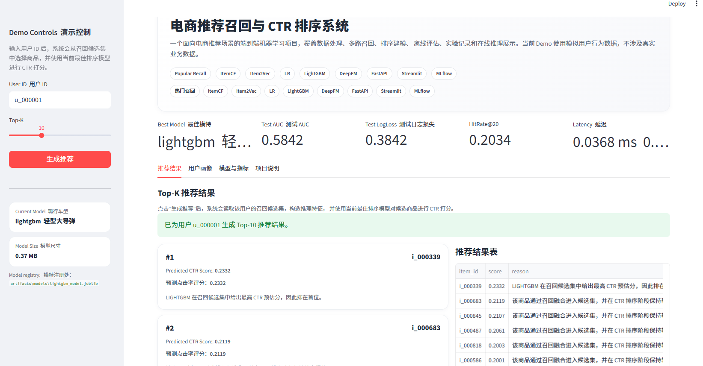
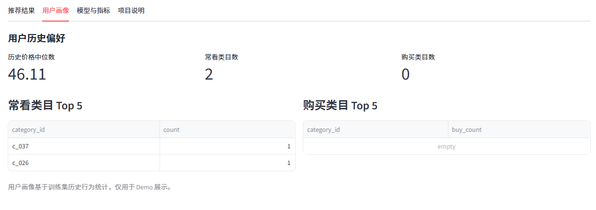
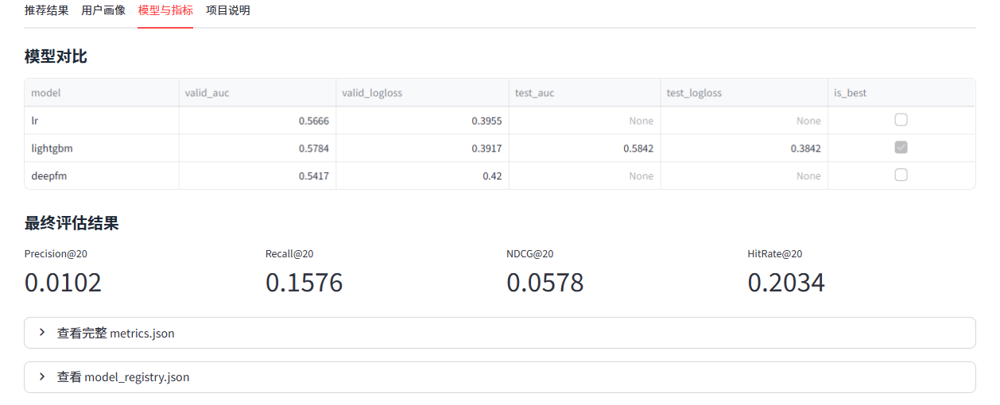
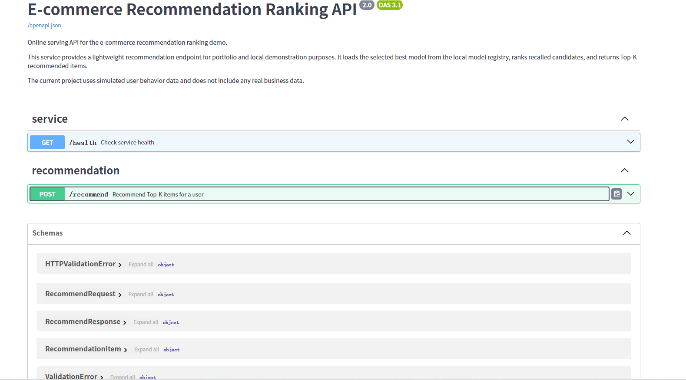
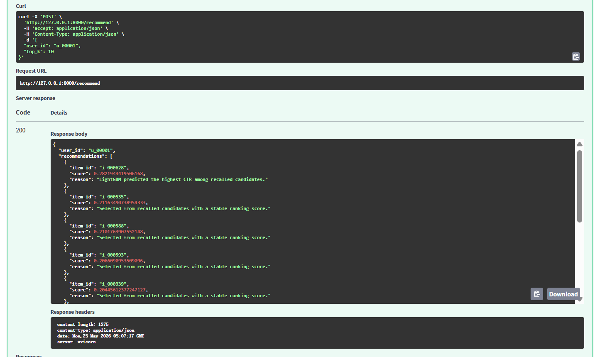
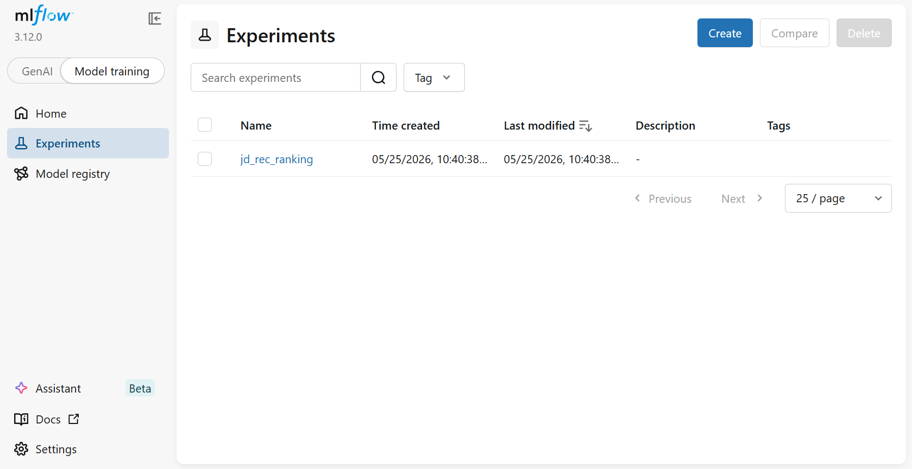

# 电商推荐召回与 CTR 排序系统

一个面向电商推荐场景的端到端推荐系统项目，覆盖用户行为数据处理、多路召回、CTR 排序建模、离线评估、实验管理、在线推理服务和可视化 Demo。

本项目使用模拟电商用户行为数据构建实验流程，不涉及真实业务数据。项目重点在于复现工业推荐系统中的核心链路，并展示推荐算法、特征工程、模型评估和工程化落地能力。

---

## 项目亮点

- 实现端到端推荐系统流程：数据处理、召回、排序、评估、服务化、可视化展示；
- 实现多路召回策略：Popular Recall、ItemCF、Item2Vec；
- 对比三类 CTR 排序模型：Logistic Regression、LightGBM、DeepFM；
- 使用 AUC、LogLoss、HitRate@K、NDCG@K 等指标进行离线评估；
- 使用 MLflow 记录实验过程与模型指标；
- 使用模型注册文件管理当前最佳模型；
- 使用 FastAPI 提供在线推荐接口；
- 使用 Streamlit 构建推荐系统展示页面；
- 支持模型不可用或召回为空时的热门商品 fallback 机制。

---

## 项目流程

```text
用户行为数据
    ↓
数据清洗与时间切分
    ↓
特征工程
    ↓
多路召回
    ↓
CTR 排序模型训练
    ↓
模型对比与离线评估
    ↓
MLflow 实验记录
    ↓
模型注册
    ↓
FastAPI 在线推理服务
    ↓
Streamlit 推荐展示 Demo
```

---

## 技术栈

| 模块 | 技术 |
|---|---|
| 编程语言 | Python |
| 数据处理 | pandas, numpy |
| 召回算法 | Popular Recall, ItemCF, Item2Vec |
| 排序模型 | Logistic Regression, LightGBM, DeepFM |
| 模型评估 | AUC, LogLoss, HitRate@K, NDCG@K |
| 实验管理 | MLflow |
| 在线服务 | FastAPI |
| 可视化展示 | Streamlit |
| 项目管理 | 配置文件、脚本化运行、本地模型注册 |

---

## 模型效果

### 验证集模型对比

| Model | Valid AUC | Valid LogLoss |
|---|---:|---:|
| LR | 0.5666 | 0.3955 |
| LightGBM | 0.5784 | 0.3917 |
| DeepFM | 0.5417 | 0.4200 |

从验证集结果看，LightGBM 的 AUC 最高，LogLoss 最低，因此被选为当前在线推理模型。

### 测试集结果

| Metric | Value |
|---|---:|
| Test AUC | 0.5842 |
| Test LogLoss | 0.3842 |

### Top-K 推荐评估

| Metric | Value |
|---|---:|
| HitRate@5 | 0.0379 |
| HitRate@10 | 0.0966 |
| HitRate@20 | 0.2034 |
| NDCG@20 | 0.0578 |

### 系统效率指标

| Metric | Value |
|---|---:|
| Model Size | 0.37 MB |
| Average Inference Latency | 0.0368 ms |

---

## 项目截图

### Streamlit 推荐展示



### 用户画像页面



### 模型指标对比



### FastAPI 接口文档



### FastAPI 推荐接口返回结果



### MLflow 实验记录



---

## 项目结构

```text
jd-ecommerce-rec-ranking-v2
├── app
│   └── streamlit_app.py              # Streamlit 推荐展示页面
├── artifacts
│   └── model_registry.json           # 当前最佳模型注册信息
├── configs
│   └── config.yaml                   # 项目配置文件
├── data
│   ├── raw                           # 原始模拟数据
│   └── processed                     # 处理后的训练、验证、测试数据
├── docs
│   ├── project_report.md             # 项目报告
│   └── screenshots                   # 项目截图
├── mlruns                            # MLflow 实验记录
├── reports
│   └── metrics                       # 模型评估结果
├── scripts                           # 数据处理、召回、训练、评估脚本
├── src
│   ├── data                          # 数据生成与处理
│   ├── features                      # 特征工程
│   ├── recall                        # 召回模块
│   ├── models                        # 排序模型
│   ├── evaluation                    # 离线评估
│   ├── serving                       # FastAPI 在线服务
│   └── utils                         # 通用工具函数
└── tests                             # 基础测试
```

---

## 快速开始

### 1. 克隆项目

```bash
git clone <your-repo-url>
cd jd-ecommerce-rec-ranking-v2
```

### 2. 创建环境

```bash
conda create -n jd-rec python=3.10 -y
conda activate jd-rec
pip install -r requirements.txt
```

### 3. 运行训练流程

```bash
python scripts/run_train_all.py
```

训练完成后，会生成模型文件、评估指标和模型注册文件。

---

## 启动 MLflow

```bash
mlflow ui --backend-store-uri mlruns --port 5000
```

浏览器打开：

```text
http://127.0.0.1:5000
```

在 MLflow 页面中可以查看：

- `lr`
- `lightgbm`
- `deepfm`
- `valid_auc`
- `valid_logloss`

---

## 启动 FastAPI 服务

```bash
uvicorn src.serving.api:app --host 127.0.0.1 --port 8000
```

接口文档地址：

```text
http://127.0.0.1:8000/docs
```

主要接口：

```text
GET /health
POST /recommend
```

请求示例：

```json
{
  "user_id": "u_000001",
  "top_k": 10
}
```

响应示例：

```json
{
  "user_id": "u_000001",
  "recommendations": [
    {
      "item_id": "i_000628",
      "score": 0.2822,
      "reason": "LightGBM predicted the highest CTR among recalled candidates."
    }
  ]
}
```

---

## 启动 Streamlit Demo

```bash
streamlit run app/streamlit_app.py
```

浏览器打开：

```text
http://localhost:8501
```

页面功能包括：

- 用户 ID 输入；
- Top-K 推荐数量选择；
- 推荐结果展示；
- 用户历史偏好展示；
- 模型指标对比；
- 项目流程说明。

---

## 推荐系统设计说明

### 多路召回

本项目实现了三类召回策略：

| 召回方式 | 说明 |
|---|---|
| Popular Recall | 基于商品整体热度召回，适合作为冷启动和 fallback 策略 |
| ItemCF Recall | 基于商品共现相似度召回，能够利用用户历史行为 |
| Item2Vec Recall | 基于商品向量相似度召回，能够捕捉商品之间的隐含关系 |

多路召回结果会被合并为候选商品集合，再交给排序模型进行 CTR 预测。

### CTR 排序

本项目对比了三类排序模型：

| 模型 | 作用 |
|---|---|
| Logistic Regression | 线性 baseline，训练快，可解释性强 |
| LightGBM | 表格特征表现稳定，最终被选为在线推理模型 |
| DeepFM | 用于探索深度 CTR 模型在当前数据规模下的表现 |

---

## 实验管理

本项目使用 MLflow 记录模型实验过程，核心记录内容包括：

- 模型名称；
- 模型参数；
- 验证集 AUC；
- 验证集 LogLoss；
- 训练时间；
- 模型实验 run。

当前实验包括：

```text
lr
lightgbm
deepfm
```

---

## 模型注册

训练完成后，项目会根据验证集指标选择当前最佳模型，并写入：

```text
artifacts/model_registry.json
```

FastAPI 和 Streamlit 会读取该注册文件，自动加载当前最佳模型。

---

## 工程化设计

本项目不仅包含模型训练，还实现了完整的工程化闭环：

- 配置化管理路径和参数；
- 脚本化运行数据处理、训练和评估；
- 使用 MLflow 管理实验结果；
- 使用模型注册文件管理最佳模型；
- 使用 FastAPI 提供在线推理接口；
- 使用 Streamlit 构建可视化 Demo；
- 使用 fallback 机制保证服务可用性。

---

## 项目报告

完整项目报告见：

[docs/project_report.md](docs/project_report.md)

项目报告中包含更详细的内容：

- 项目背景；
- 数据说明；
- 推荐流程设计；
- 召回算法说明；
- 排序模型说明；
- 模型评估结果；
- 在线服务设计；
- 工程化设计；
- 项目局限性；
- 后续优化方向。

---

## 项目局限性

本项目仍然存在一些局限：

- 当前数据为模拟数据，无法完全反映真实电商业务中的长尾分布和实时反馈；
- DeepFM 在当前小规模数据下表现弱于 LightGBM，后续可在更大规模数据上继续调参；
- 当前推荐理由主要用于 Demo 展示，真实业务中需要更细粒度的可解释推荐设计；
- 当前服务为本地单机 Demo，尚未接入 Redis、Kafka、特征服务和 A/B 实验平台；
- 当前排序目标较单一，后续可扩展为点击率、转化率、GMV 等多目标排序任务。

---

## 后续优化方向

- 增加冷启动用户和冷启动商品处理策略；
- 增加召回通道效果评估；
- 优化 DeepFM 模型结构和训练参数；
- 引入 Redis 缓存热门商品和候选集；
- 增加在线服务日志和模型监控；
- 扩展为多目标排序任务；
- 构建更完整的 A/B 实验模拟流程。

---

## 总结

本项目完成了一个从离线实验到在线服务的电商推荐排序系统。项目覆盖了多路召回、CTR 排序模型训练、模型效果对比、Top-K 推荐评估、MLflow 实验管理、模型注册、FastAPI 在线推理和 Streamlit 可视化展示。

整体来看，本项目展示了推荐系统从算法设计、特征工程、模型训练、离线评估到工程化部署的完整闭环。